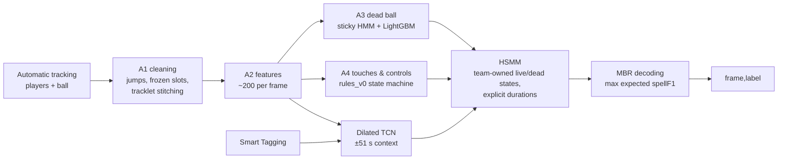

# Pompeu Data Team — frame-level ball possession from automatic tracking

**More Than A Hack 2027, Phase 1** (Barça Innovation Hub × Metrica Sports × Mobile World Capital Barcelona).
Task: for each of the **199,319 frames** of a full LaLiga match (FC Barcelona – Athletic Club), say who has the ball
(`H` home, `A` away, `D` dead ball). The input is automatic, uncorrected tracking in which **the ball is invisible on 41%
of the scored frames**. Ranked on **spellF1**, a metric that counts whole possessions rather than individual frames.

📄 **Technical document:** [paper/PompeuDataTeam.pdf](paper/PompeuDataTeam.pdf) ([Markdown](paper/PompeuDataTeam.md)) ·
🧱 **Module-by-module design:** [ARQUITECTURA.md](ARQUITECTURA.md) · 🏁 **Original challenge:** [ORGANISERS.md](ORGANISERS.md)

## Result

| | spellF1 |
|---|---|
| Organisers' published baseline, full match | 0.243 |
| **Our submission (`hsmm_tcn`), private full match** | **0.458**: rank **303 of 759** submissions (top 40%), 1.9× the baseline |
| Winning submission | 0.710 |

The repository regenerates the submitted file **bit for bit** from a clean clone: same sha256, on CPU, with no
manual steps ([Reproduce](#reproduce)).

We also wrote up honestly where our validation went wrong: it predicted 0.678 and the private match gave 0.458.
See [Post-mortem](#post-mortem-what-we-would-do-differently).

## How it works



- **Possessions as objects, not frames.** spellF1 matches possession runs by temporal IoU, and per-frame voting
  fragments them. On our bench, smoothed voting predicted twice as many possessions as there were. So we segment the
  match with a **hidden semi-Markov model**. It has explicit durations and four states: live and dead, each owned by a team.
  Owning the dead-ball state by team builds the restart rule into the model, since the team that restarts usually keeps the ball.
- **Experts combined by product of experts.** The HSMM receives three sources of evidence:
  - a dead-ball detector: an HMM over physical cues plus a LightGBM model, with dead-ball F1 0.911 on held-out matches;
  - touch and control events with a rule-based possession state machine;
  - a **dilated temporal CNN** (about 0.5 M parameters, about ±51 s of context). It reads collective, ball-free context and
    the organisers' Smart Tagging phases to give team evidence inside long ball gaps.
- **Decoding for the metric.** Minimum-Bayes-risk decoding over 200 posterior samples, with a boundary search on
  expected spellF1.
- **No hand labels anywhere.** Everything that learns is trained on **public matches from other competitions**: DFL/IDSSE
  (7 matches, CC BY 4.0), Metrica sample data (3) and SkillCorner open data (20). Their tracking is degraded by a seeded simulator
  so that it looks like the challenge tracking: ball gaps, blur, displaced points, identity swaps, frozen players.

### Validation discipline
- Splits by whole match (`train` / `val` / `test`). Weights are fitted on `val` only.
- **One pre-registered `test` pass** for the final candidate. The criterion was written before running it.
- Block-bootstrap 5–95% intervals.
- Every candidate is scored under three label conventions (2 / 5 / 8 s), because the hidden ground truth's convention
  for very short possessions was unknown.
- The public five minutes of ground truth were used **only** to check the pipeline (format, alignment, team
  orientation), never to train, tune or select.

### Line B: ball from the video (explored, not submitted)

| Step | Result |
|---|---|
| Video decoding | Exactly 199,319 frames, matching the tracking clock |
| Ball pseudo-labels | 88,937, projected through the homography, for a detector |
| Broadcast alignment | The broadcast tracking aligned to the tactical clock from player positions alone (median error 0.29 m), with replays discarded |
| Fusion | Physically constrained; ball coverage of scored frames goes from 59.2% to about 62.5% |

A coverage sweep showed that one point of coverage is worth about +0.0025 spellF1. The broadcast's +3 points
(≈ +0.01) were within the noise, so it was left out of the submission.

## Post-mortem: what we would do differently

Our pre-registered external test predicted **0.678 [0.647, 0.709]**, and the private match gave **0.458**. After the
results we compared our approach with other teams' public write-ups. These are the lessons. They are hypotheses from that
comparison: none of them has been re-measured.

1. **The simulator was not hard enough.** The teams that scored highest degraded their training data to remove the
   shortcut "ball missing ⇒ dead ball". They kept the ball moving during stoppages and reproduced the challenge's long
   ball-gap blocks. The validation benches that predicted the private score well were built deliberately to be as hard
   as the real match.
2. **Our cross-check signal was there.** On the public window the submission scored 0.444, against 0.678 on our bench.
   We followed the rule not to select on that window. Still, we should have read a 0.23 gap as a sign that something
   does not transfer and investigated the bench, before freezing.
3. **More matches, cross-validated.** We held out 5 of our 10 well-labelled matches for `val` / `test`. Leave-one-match-out
   cross-validation, plus larger public sets (for example the PFF FIFA World Cup 2022 tracking), would have given the
   learned experts far more to learn from.
4. **Validate exactly what you ship.** On the real match the TCN read the real Smart Tagging. Our external `test` matches
   have no tagging, so that exact configuration was never measured out of sample.
5. **Team attribution is the lever.** Getting the team right inside ball gaps matters much more than dead-ball accuracy.
   Cheap team switches gated by a learned change signal, with live/dead switches kept expensive, beat hand-set duration
   priors fitted on two matches.
6. **Spend effort where the metric is.** The video and broadcast line was solid engineering, and we measured early that it
   was worth about +0.01. That time belonged in the simulator and the team model.

## Reproduce

**1. Environment:** Python **3.11** (the lock pins numpy 2.0.2, which has no wheels for 3.13). The submission needs
torch on CPU, so install `requirements-cpu-torch.lock` (it is `requirements.lock` plus torch 2.9.1+cpu; no GPU is used):

```bash
# Linux / macOS
python3.11 -m venv .venv && source .venv/bin/activate
pip install -r requirements-cpu-torch.lock

# Windows (PowerShell): install Python 3.11 first; keep the venv on a short path,
# because with a long path numba's DLL fails to load
py -3.11 -m venv C:\venvs\pompeu
C:\venvs\pompeu\Scripts\activate
pip install -r requirements-cpu-torch.lock
```

With [uv](https://docs.astral.sh/uv/) instead: `uv venv --python 3.11 C:\venvs\pompeu` and
`uv pip install --python C:\venvs\pompeu\Scripts\python.exe --index-strategy unsafe-best-match -r requirements-cpu-torch.lock`
(uv needs `--index-strategy unsafe-best-match` because the lock mixes PyPI and the PyTorch CPU index).
`container/pompeu.def` builds the same environment as an Apptainer image.

**2. Data:** the match data is licensed to participants only, and **none of it is in this repository**. Unpack the
bundle into `data/` as described in [data/README.md](data/README.md), or point `MTAH_DATA_DIR` at it. Parsed tracking
is cached in `cache/` (move it with `POMPEU_CACHE_DIR`). A run from an empty cache takes about 1.5 minutes.

**3. Regenerate the submission:**

```bash
python scripts/make_submission.py --config configs/final.yaml --out PompeuDataTeam.csv
python evaluation/validate_submission.py PompeuDataTeam.csv
```

Expected `sha256`: `8959a2ce91303dbb0d6d05c516af80c771266eda9491dd12cb223d0de72a2379`. It was reproduced twice with
different empty caches.

The TCN weights are committed (`artifacts/tcn_v1.pt`, trained on public external data only) and pinned by hash in the
config (`7aea823756b71b7e`), so the pipeline stops if they differ. To retrain them deterministically on CPU, follow
"Reproduce the shipped model" in [results/tcn_report.md](results/tcn_report.md) (training-run hash `ceecf8915830d7c0`).

**Tests:** `python -m pytest` (about 3 minutes with the data). Tests that need the data skip themselves without it.

**External bench:** `python scripts/prepare_external.py --matches all`, clone the Metrica sample data into
`data/external/metrica/sample-data`, then `python scripts/run_validation.py --config configs/final.yaml`.

## Repository map

```
pompeu/            the library: io (tracking contract), clean (A1), features (A2), events (A3–A4),
                   models (HSMM), experimental (TCN), external (bench + degradation), vision (Line B)
configs/           one YAML per experiment; configs/final.yaml is the submission
scripts/           make_submission, run_validation, bench preparation, experiments
artifacts/         committed model weights, pinned by hash
results/           leaderboard of every experiment and per-module reports (no match data)
paper/             the technical document
evaluation/, starter/   the organisers' scorer, baselines and loaders, unchanged
```

## Team

**Martí** ([@marticasasn](https://github.com/marticasasn)): delivery, technical document, video and broadcast line.
**Sergi** ([@sergicasesalonso](https://github.com/sergicasesalonso)): models and external bench.
**Ander**: review, reproduction and ball and whistle detectors.

## Licence

The repository keeps the MIT licence of the organisers' starter kit ([LICENSE](LICENSE)). The match data is **not**
covered: it was licensed for this competition only. External datasets keep their own licences: DFL/IDSSE CC BY 4.0, SkillCorner open
data MIT, and Metrica sample data credited to Metrica Sports.
